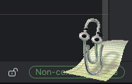
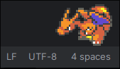

# Bongo Cat + V-Pets Wayland Overlay

[](https://opensource.org/licenses/MIT)
[](https://github.com/furudbat/wayland-vpets/releases)
[](https://github.com/furudbat/wayland-vpets/actions/workflows/release.yml)

A passive Wayland overlay that puts an animated pet on your screen, reacting to your keyboard.

  
_Classic Bongocat_

  
_Digimon V-Pets_

  
_Clippy_

  
_Pokemon_

## Features

- **Pets**
  - Bongocat 😺
  - Digimon V-Pets 🦖
  - Clippy 📎
  - Pokémon 🐭
  - Custom sprite sheets 🎨
- Reacts to every keyboard instantly
- Live configuration reload
- Hides under fullscreen windows
- Idle and scheduled sleep
- SVG artwork, sharp at any size and scale
- Happy animation triggered by KPM threshold
- Randomize sprite on startup
- React to CPU usage
- Movement animation
- Evolution (Digimon & Pokémon grow over time)

Requires a compositor with `wlr-layer-shell` (Sway, Hyprland, Niri, river, Wayfire and others).

## Quick Start

```bash
# Arch Linux - latest release
yay -S wpets

# Arch Linux - latest commits
yay -S wpets-git
```
For other distros, see [Building](#building).

Reading keyboards needs access to `/dev/input`:
```bash
sudo usermod -a -G input $USER   # then log out and back in
```

Run it:
```bash
wpets-all --watch-config
```

**No keyboard is used by default, use `wpets-all --default-devices` for using every keyboard by default.**
`wpets-all --list-devices` shows each input device, marks keyboards, and prints `keyboard_name=` and `keyboard_device=` lines you can paste into the configuration to pick specific ones. 
`wpets-all --doctor` checks the configuration, device access and compositor support at once.
Or find your devices with `wpets-find-devices`

## Configuration

The configuration is read from `$XDG_CONFIG_HOME/bongocat/bongocat.conf`,
`~/.config/bongocat/bongocat.conf` or `./bongocat.conf`, or from `-c FILE`.
Every setting is optional; [`bongocat.conf.example`](bongocat.conf.example)
documents each one. For example, a large cat at the bottom of the screen:

```ini
cat_height=110
overlay_height=120
overlay_position=bottom
overlay_opacity=0
cat_align=center
cat_x_offset=0
cat_y_offset=0

animation_name=bongocat
```


For the full options reference, sprite list, evolution, and custom sprite sheet docs, see **[docs/configuration.md](docs/configuration.md)**.

## Usage Examples

```bash
wpets-all --watch-config --config ~/.config/bongocat/bongocat.conf
wpets-all --watch-config --config ~/.config/bongocat/digimon.bongocat.conf
wpets-all --watch-config --config ~/.config/bongocat/clippy.bongocat.conf
wpets-pkmn --watch-config --config ~/.config/bongocat/pmd.bongocat.conf
wpets-ms-agent --watch-config --config ~/.config/bongocat/rover.bongocat.conf
```

> `wpets` is the minimal binary. `wpets-all` bundles most sprites and is the recommended default.

For CLI flags, Hyprland autostart, ricing tips, and more config examples, see **[docs/usage.md](docs/usage.md)**.

## Troubleshooting

<details>
<summary>Permission denied on input devices</summary>

add yourself to the `input` group as shown above, then log in again. 
`bongocat --list-devices` shows which devices are inaccessible.

```bash
sudo usermod -a -G input $USER
# Then log out and back in
```

</details>

<details>
<summary>Pet ignores the keyboard</summary>

use `wpets-all --list-devices` shows which devices are inaccessible.

1. Run `wpets-find-devices` to find correct device
2. Update `keyboard_device` in config
3. Restart bongocat

</details>

<details>
<summary>Pet on the wrong monitor</summary>

Set `monitor=YOUR_MONITOR` in config to a name from `wpets-all --list-monitors`. 
Or find names with `wlr-randr` or `hyprctl monitors`.

</details>

<details>
<summary>Pet hidden behind waybar</summary>

Both run on the same Wayland layer. Delay startup: `exec-once = sleep 5 && wpets-all ...`

</details>

<details>
<summary>Pet still over fullscreen windows</summary>

Use an other layer than `overlay` or toggle visibility via signal: `USR1`
```bash
kill -USR1 <bongocat_pid>
```


</details>

## Building

```bash
git clone https://github.com/furudbat/wayland-vpets.git
cd wayland-vpets
cmake -S . -B build -DCMAKE_BUILD_TYPE=Release
cmake --build build
```

**Requirements:** `wayland-client`, `make`, `cmake` and a C++26/C23 compiler (gcc15 or clang19).

### Installation from source

```bash
git clone https://github.com/furudbat/wayland-vpets.git
cd wayland-vpets
cmake -S . -B build -DCMAKE_BUILD_TYPE=Release
cmake --build build
sudo cmake --install build
```

> ⚠️ If you already have [bongocat](https://github.com/saatvik333/wayland-bongocat) installed, system-wide install may conflict.

### Alternative Permissions Setup (experimental) -- setgid setup

1. `sudo groupadd --system bongocat` -- Create `bongocat` group for input devices
2. Create `/etc/udev/rules.d/70-bongocat.rules`:
```bash
SUBSYSTEM=="input", KERNEL=="event*", GROUP="bongocat", MODE="0640"
```
3. Reload udev rules:
```bash
sudo udevadm control --reload-rules
sudo udevadm trigger --subsystem-match=input
```
4. setgid for binary
```bash
sudo chgrp bongocat /usr/bin/wpets-all
sudo chmod 2755 /usr/bin/wpets-all
```

#### TODO: keep group and mode when installing via AUR

## License

MIT License - see [LICENSE](LICENSE)