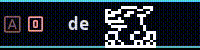
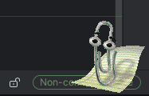
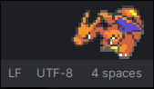

# Bongo Cat + V-Pets Wayland Overlay

[](https://opensource.org/licenses/MIT)
[](https://github.com/furudbat/wayland-vpets/releases)
[](https://github.com/furudbat/wayland-vpets/actions/workflows/release.yml)

A passive Wayland overlay with an animated pet that plays along with your keyboard.
Fork of [wayland-bongocat](https://github.com/saatvik333/wayland-bongocat) with just more pets.

- Pets: Bongocat, Digimon V-Pets, Pokémon, Clippy, Neko and custom sprite sheets
- Reacts to every keyboard instantly
- Hides under fullscreen windows
- Idle and scheduled sleep, happy animation at a KPM threshold
- Reacts to CPU usage and audio (optional)
- moves around
- Evolution: Digimon and Pokémon grow over time
- Bongocat SVG artwork, sharp at any size and scale; Pixel-artwork also sales
- Live configuration reload

Requires a compositor with `wlr-layer-shell` (Sway, Hyprland, Niri, river, Wayfire and others).

  
_Classic Bongocat_

  
_Digimon V-Pets_

  
_Clippy_

  
_Pokemon_


## Quick Start

```bash
# Arch Linux
yay -S wpets        # latest release
yay -S wpets-git    # latest commits
```

For other distros, see [Building](#building).

Reading keyboards needs access to `/dev/input`:

```bash
sudo usermod -a -G input $USER   # then log out and back in
```

Run it:

```bash
wpets-all --watch-config --default-devices
```

**No keyboard is used by default;** Use `--default-devices` for every keyboard.  

`wpets-all --list-devices` shows each input device, marks keyboards, and prints `keyboard_name=` and `keyboard_device=` lines so you can paste it into the configuration or pick specific ones.

`wpets` is the minimal binary (Bongocat only). `wpets-all` bundles most sprites and is the recommended default; `wpets-pkmn` and `wpets-ms-agent` carry the larger Pokémon and MS Agent sets.

## Configuration

The configuration is read from `$XDG_CONFIG_HOME/bongocat/bongocat.conf`,
`~/.config/bongocat/bongocat.conf` or `./bongocat.conf`, or specify with `-c FILE`.  
Every setting is optional; [`bongocat.conf.example`](bongocat.conf.example) documents each one. For example, a large Agumon at the bottom of the screen:

```ini
animation_name=Agumon
enable_antialiasing=0

cat_height=110
overlay_height=120
overlay_opacity=0
overlay_position=bottom
cat_x_offset=0
cat_y_offset=0
cat_align=center
```

See **[docs/configuration.md](docs/configuration.md)** for every option, the sprite list, evolution and custom sprite sheets.

## Command Line

```
wpets-all [OPTIONS]
  -c, --config FILE      Configuration path (searched by default, "-" for stdin)
  -w, --watch-config     Reload when the configuration changes
  -m, --monitor NAME     Show the pet only on this monitor
  -t, --toggle           Stop the running pet, or start one
  --random               Start with a random sprite
  --default-devices      Use every keyboard when none is configured
  --check-config         Strictly validate the configuration
  --list-devices         List input devices and keyboard settings
  --list-monitors        List monitors, sizes and scales
  --doctor               Check configuration, devices and compositor support
  -h, --help             Show all options
  -v, --version          Show version
```

`kill -USR2 <pid>` reloads the configuration,  
`kill -USR1 <pid>` hides or shows the bar.  

See **[docs/usage.md](docs/usage.md)** for all flags, Hyprland  autostart and more examples.

## Troubleshooting

- **Permission denied on input devices:** add yourself to the `input` group as shown above, then log in again. `wpets-all --list-devices` shows which devices are inaccessible.
- **Pet ignores the keyboard:** check that `keyboard_device`/`keyboard_name` match your keyboard (`wpets-all --list-devices`), or start with `--default-devices`.
- **Pet on the wrong monitor:** set `monitor=` to a name from `wpets-all --list-monitors`.
- **Pet hidden behind waybar:** both use the same layer; delay startup, e.g. `exec-once = sleep 5 && wpets-all ...`.
- **Pet over fullscreen windows:** use an `overlay_layer` other than `overlay`, or hide it with `kill -USR1 <pid>`.

## Building

```bash
git clone https://github.com/furudbat/wayland-vpets.git
cd wayland-vpets
cmake -S . -B build -DCMAKE_BUILD_TYPE=Release
cmake --build build
sudo cmake --install build
```

### With Audio Component

```bash
git clone https://github.com/furudbat/wayland-vpets.git
cd wayland-vpets
cmake -S . -B build -DCMAKE_BUILD_TYPE=Release -DENABLE_AUDIO_MODULE=ON
cmake --build build
sudo cmake --install build
```

Requirements: `wayland-client`, `libudev`, `cmake` and a C23/C++23 compiler (GCC 15 or Clang 19).  
Audio support is optional: `-DENABLE_AUDIO_MODULE=ON` needs `libpipewire-0.3` and `fftw3`.

A source install names the binaries `bongocat`, `bongocat-all`,
`bongocat-pkmn`, ... and `bongocat-find-devices`; the `wpets-*` names come from the AUR package.

> ⚠️ If you already have [bongocat](https://github.com/saatvik333/wayland-bongocat) installed, a system-wide install with cmake may conflict.

<details>
<summary>Alternative permissions setup (experimental, setgid)</summary>

1. Create a group for input devices: `sudo groupadd --system bongocat`
2. Create `/etc/udev/rules.d/70-bongocat.rules`:
   ```
   SUBSYSTEM=="input", KERNEL=="event*", GROUP="bongocat", MODE="0640"
   ```
3. Reload the udev rules:
   ```bash
   sudo udevadm control --reload-rules
   sudo udevadm trigger --subsystem-match=input
   ```
4. Set the group on the binary:
   ```bash
   sudo chgrp bongocat /usr/bin/wpets-all
   sudo chmod 2755 /usr/bin/wpets-all
   ```

</details>

## License

MIT License - see [LICENSE](LICENSE)  
Sprite copyrights and third-party libraries are listed in [docs/fragments/copyright.md](docs/fragments/copyright.md) and [docs/fragments/license.md](docs/fragments/license.md).
